# agent-telegram: Codex and Claude Code in your pocket

**English** | [中文](README_zh.md)

Version: 0.1.0 (2026-11-13)

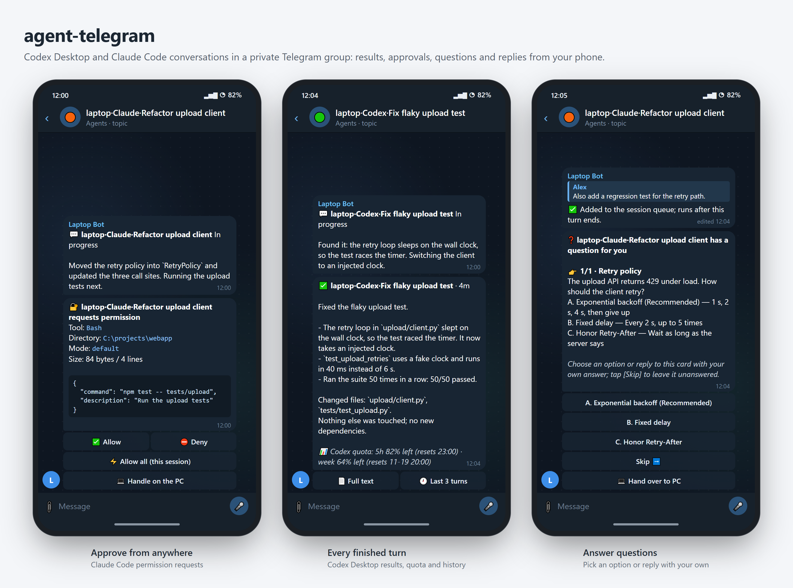

agent-telegram runs in the background on your Windows computer and connects Codex Desktop and Claude Code (the desktop app's Code tab or the terminal CLI) to a private Telegram group. Every finished turn shows up on your phone. From there you can answer Claude's permission prompts, questions and plans, approve Codex commands, send the next instruction or interrupt a turn, without walking back to your desk.

- **One topic per conversation**, named `machine·Agent·title`, such as `laptop·Claude·Refactor upload client`.
- **Every finished turn**: status (✅/❌/⏹), elapsed time, about 1,500 characters of the redacted final answer and the remaining plan quota. **📄 Full text** gets the whole answer; **🕘 Last 3 turns** shows recent history.
- **Progress while you wait**: what the agent says to you during a turn appears in one progress message, updated at most every 30 seconds. Private reasoning is never pushed.
- **Approvals, questions and plans** arrive as cards with buttons. The card and the dialog on your computer race; whichever answers first wins.
- **Reply from your phone**: text typed in a topic becomes a proposed message. The bot repeats the recipient and text and sends only after you confirm.
- **Quiet while you are at your desk**: pushes are silent while the computer is unlocked and its keyboard or mouse was used within three minutes. Requests for your attention make a sound once you are away.
- **Several computers, one group**: each computer has its own bot, and `/list`, `/status` and `/lang` are answered by every one of them.
- **English or Chinese** interface, switchable from Telegram with `/lang`.
- Optional, view-only readers for Antigravity, Pi and DSH (DeepSeek Harness), **off by default**.

## See it in action

Each animation shows one interaction from both sides: the computer on the left, the Telegram group on the right. The Telegram side is the bridge's own output. Demo Claude Code and Codex sessions were run through the real bridge code, so every message, button, edit and notice is exactly what it sends. The computer side is a mock-up of Claude Code in a terminal and of the Codex Desktop window, kept in step with the bridge. Session titles, commands and answers are made up. The [Chinese README](README_zh.md) shows the same flows with the bot set to Chinese.

### Claude Code

**Approve tool calls.** A permission request becomes a card with the tool, directory, mode and full input, while the usual dialog stays open on the computer; whichever answers first wins. **✅ Allow** permits once, **⛔ Deny** refuses, **💻 Handle on the PC** leaves it to the dialog on your computer, and **⚡ Allow all (this session)** asks for a second tap.

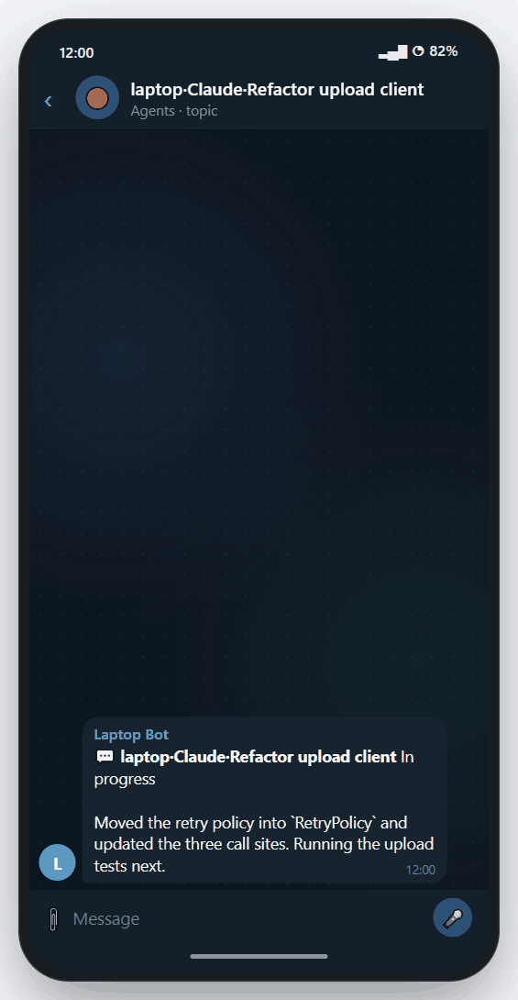

**Answer questions.** When Claude asks you something, the same options appear on the card. Pick one or reply to the card with your own answer, check the summary, then tap **📨 Send answers**. Claude gets the answer on the computer and carries on.

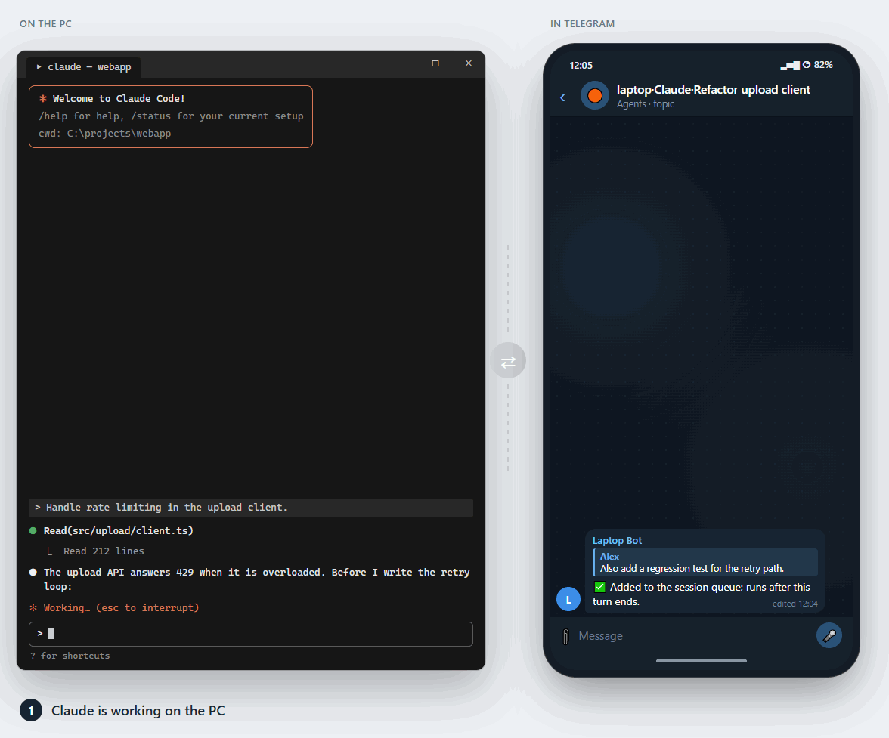

**Approve plans.** A plan waiting for approval arrives in full. **✅ Approve plan** lets Claude leave plan mode and start; **✏️ Keep planning**, or a reply with your changes, sends it back.

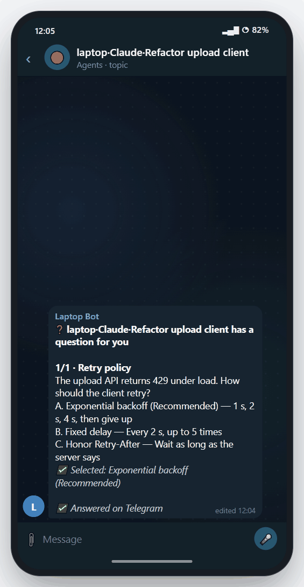

**Send the next instruction.** Type in the conversation's topic. While Claude is busy, choose **📥 Queue** (a new turn after this one, through Claude's own queue) or **↪️ Steer** (delivered after the next tool call).

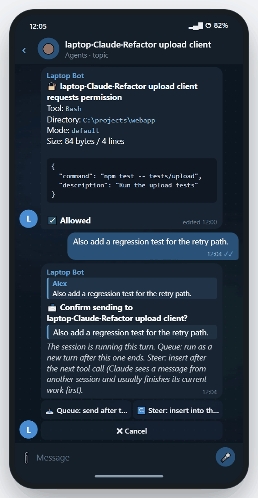

### Codex Desktop

**Turn results.** A progress message while Codex works, then the result with elapsed time and plan quota. **🕘 Last 3 turns** shows the recent history in place.

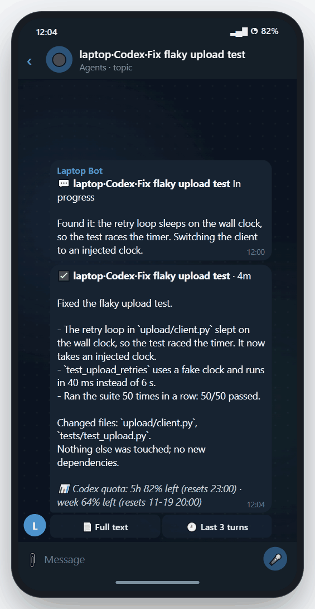

**Approve commands.** In conversations that ask before running commands or changing files, allow or deny from Telegram, or hand the request back to the PC.

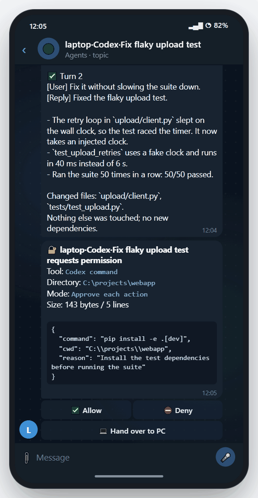

**Implement a plan.** When a plan-mode turn finishes, **🚀 Implement this plan** switches Codex back to default mode and starts the work, after a confirmation. Reply to the message instead to have Codex revise the plan.

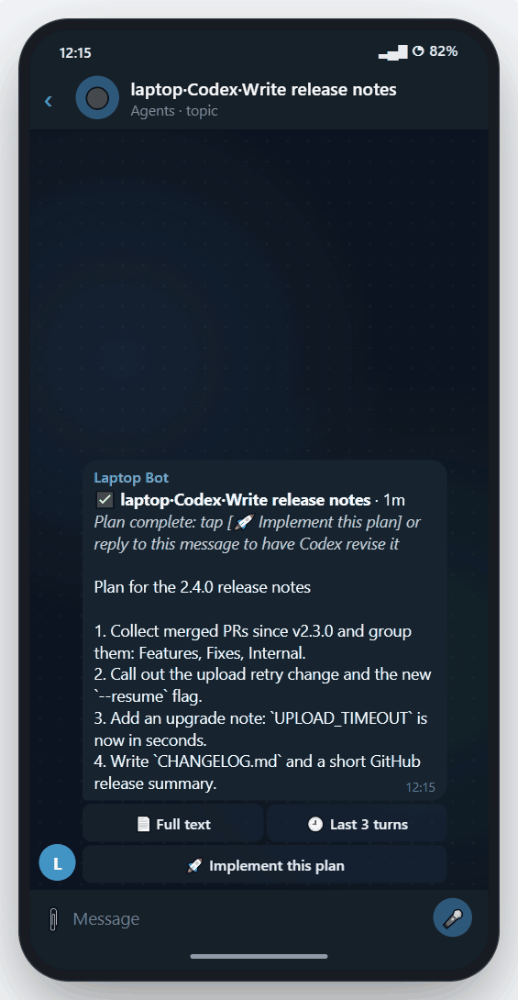

### On the phone

<table>
<tr>
<td width="33%" valign="top">

**Notifications.** Results, cards and questions arrive as ordinary Telegram notifications, so the lock screen already tells you which conversation needs you.

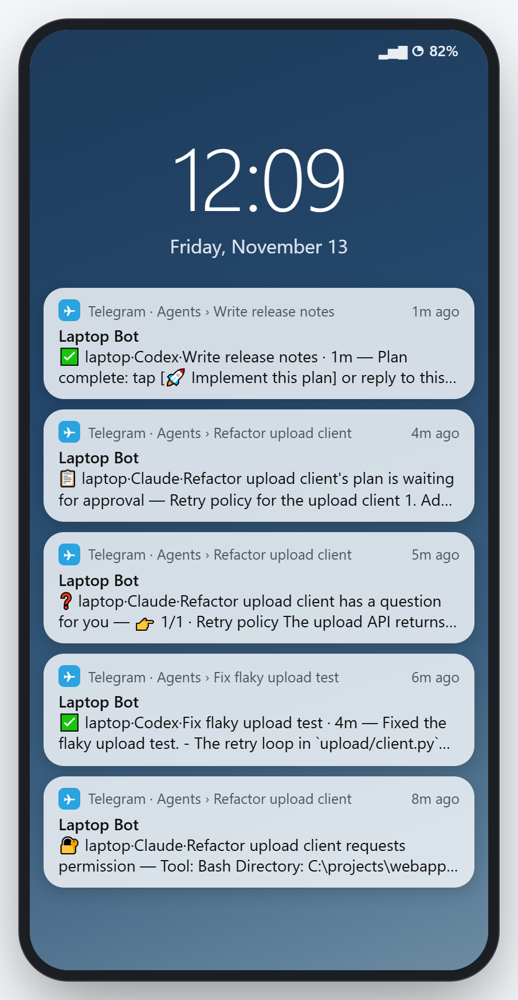

</td>
<td width="33%" valign="top">

**All your computers.** `/list` in General: every computer's bot lists its recent conversations, running ones first, with buttons that jump to each topic.

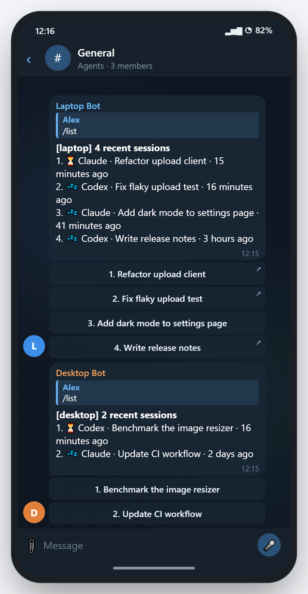

</td>
<td width="33%" valign="top">

**Language.** `/lang` shows each machine's language with **English / 中文** buttons; `/lang en` or `/lang zh` switches every machine at once.

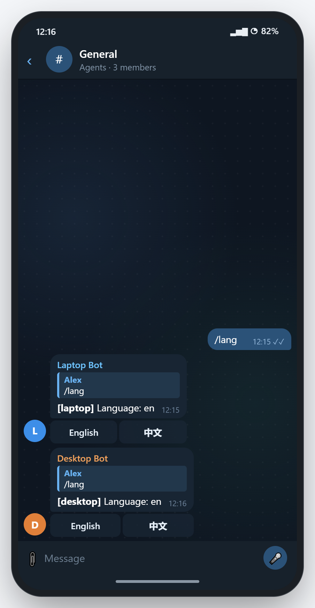

</td>
</tr>
</table>

## Capabilities and limits

| Capability | Codex Desktop | Claude Code | Antigravity (optional) | Pi (optional) | DSH (optional) |
|---|---|---|---|---|---|
| Completed-turn notifications | Local rollouts | Hooks | View only | View only | View only |
| Send messages | App-tools pipe, without switching the displayed conversation | Running: session inbox (idle starts a turn; busy receives between tool calls). Closed: background `claude -p --resume`, requiring CLI login | No | No | No |
| Interrupt `/stop` | No remote interface; stop on the computer | Next tool call; an already running command finishes first | No | No | No |
| Permission approval | Command and file approvals: Allow / Deny / Hand over to PC (conversations whose approval policy is not `never`); other requests are alerts only | Allow / Deny / Allow all / Handle on the PC for non-bypass sessions | No | No | No |
| Create `/new` | A task in Codex Desktop | Background `claude -p`, within configured `roots`; requires CLI login | No | No | No |
| `/list`, `/read`, `/full`, `/status` | Yes | Yes | Yes | Yes | Yes |

Codex Desktop conversations on SSH hosts are polled through the local app every 30 seconds. Titles start with the SSH alias, such as `lab1·Deployment`. They are view only: notifications, `/list`, `/read`, and `/full` work; sending and interruption do not. Only remote conversations among the app's latest 50 conversations, plus pinned ones, are visible.

Optional readers use existing local files: Antigravity under `~/.gemini`, Pi under `~/.pi/agent/sessions` (also `~/.pi/sessions`), and DSH (DeepSeek Harness) under `~/.dsh/sessions`. They push turns and support `/list`, `/read`, `/full`, and `/status`, but cannot receive replies, stop, or create conversations. Enable them under **Configuration**.

The Antigravity reader only reads local files under `~/.gemini` (or the configured data directory). It never signs in, starts or contacts Antigravity, or contacts any Google service. Check Antigravity's terms of service before enabling it.

If you also use codex-watch, turns that failed because of a network error and will automatically continue are pushed silently, with their continuation time.

## Requirements

- Windows 10/11.
- Codex Desktop (Microsoft Store edition) and/or Claude Code (desktop app or CLI). Use either one and disable the other in configuration.
- [uv](https://docs.astral.sh/uv/), which prepares Python 3.11+ and dependencies including httpx, zstandard, and pywin32. The generated package includes `uv.lock` for tested dependency versions.
- Access to `api.telegram.org`. HTTP(S) proxies are supported; SOCKS-only proxies are not. Auto-detection tries `127.0.0.1:7897` (Clash Verge's default), then `HTTPS_PROXY`/`HTTP_PROXY`, then the Windows system proxy; otherwise it connects directly. If detection misses yours, save it with `set-token --proxy http://127.0.0.1:7890`.

## 1. Prepare Telegram

1. Use `/newbot` with @BotFather to create **one bot per computer**, such as `yourname_pc1_bot` and `yourname_pc2_bot`. **Enter the token only locally with `set-token` below. Do not share it or send it to any chat.**
2. Create a private group, enable **Topics**, turn off chat history for new members, and optionally enable message auto-deletion.
3. Add bots as administrators with only **Manage Topics**. Administrator bots receive all group messages; no privacy-mode change is needed.
4. Once all bots are in the group, use @BotFather's `/setjoingroups` → Disable for each, preventing others from adding it elsewhere.
5. Enable Telegram two-step verification in Settings → Privacy and Security. An account authorized to send bridge commands can execute instructions on your computer.

## 2. Install on each computer

Extract into a permanent directory. In **normal, non-administrator PowerShell** (SSH sessions also count as elevated), enter `agent-telegram`, containing `pyproject.toml` and `install_task.ps1`:

```powershell
uv sync
.\.venv\Scripts\python.exe -m agent_telegram set-token
# If automatic proxy detection fails:
# .\.venv\Scripts\python.exe -m agent_telegram set-token --proxy http://127.0.0.1:7890
.\.venv\Scripts\python.exe -m agent_telegram bind
```

`uv sync` creates `.venv` and installs dependencies. `set-token` accepts a hidden token and encrypts it with Windows DPAPI. `bind` displays a six-digit code: send `/bind@yourbot 123456` in the group, check the group name and account on your computer, then enter `y`. Only the account sending that command enters the allowlist.

```powershell
powershell -ExecutionPolicy Bypass -File .\install_task.ps1 -Action Install
.\.venv\Scripts\python.exe -m agent_telegram hooks install
```

The task starts the bridge hidden and runs it at logon. Skip `hooks install` for Codex-only use. It adds hooks to `~/.claude/settings.json`, first backing up to `~/.claude/backups` and preserving other settings. The bridge must be running; Claude Code reloads automatically. On upgrades, the bridge updates installed hook formats at startup if needed.

Send `/list` in the group; each computer's bot should respond. To create Claude conversations or resume closed ones, run `claude` locally and use `/login` first.

**After moving the directory or unpacking a new version**, rerun `uv sync`, `install_task.ps1 -Action Install`, and `hooks install`, in that order: `.venv` and hooks retain absolute paths. Install waits for pending send confirmations, active writes, and outgoing messages; open approval cards do not block it. If the bridge stays busy, it updates the task without restarting; rerun Install when idle.

## 3. Daily use

- `/list [n]`: recent conversations on each computer; default 10, maximum 30, running first. The first ten have topic navigation buttons.
- `/status`: bridge status. `/help`: help.
- `/lang`: each machine's language with **English / 中文** buttons. `/lang en` or `/lang zh` (the `/lang en|zh` choices) switches every machine in the group.
- Type in a conversation topic, then confirm. An idle session gets **✅ Send** / **✖ Cancel**. While a turn runs, **📥 Queue** starts a new turn after it: Claude uses its own queue; the bridge waits up to four hours for Codex, and the item is absent from Codex's own queue. **↪️ Steer** inserts into this turn: Codex continues with it; Claude sees it after the next tool call as another session's message and usually finishes the current action first.
- Question cards (Claude and Codex) let you select an option or reply with your answer, then tap **📨 Send answers**. Claude plan cards offer **✅ Approve plan** / **✏️ Keep planning**; reply to attach changes. A completed Codex plan offers **🚀 Implement this plan**.
- In a topic: `/stop` interrupts Claude; `/read [k]` reads the last k turns; `/full` sends the latest full answer (as a `.md` file when long); `/mute` / `/unmute` toggle pushes; `/ask` restores per-request permission approval.
- Claude permission cards coexist with the computer's dialog; the first answer wins. **✅ Allow** permits once; **⛔ Deny** refuses; **💻 Handle on the PC** closes the card for a local decision. **⚡ Allow all (this session)** needs a second confirmation and expires after 12 hours. `/ask`, **🔒 Restore individual approvals**, `/lock`, or restart clears it. Turn pushes report the automatic approval count.
- Codex command and file approval cards offer **✅ Allow**, **⛔ Deny** and **💻 Hand over to PC**. They appear only for conversations whose approval policy is not `never`.
- Cards are silent while you are present, and alert again when you leave. Local answers mark cards handled on the PC. Cards wait up to six hours. Subagent requests go directly to the computer while you are present; those dialogs appear after the bridge responds.
- `/new@yourbot`: guided Codex/Claude creation. Plain `/new` in General makes each machine offer a selection button.
- `/lock`: lock writes on all machines. `/unlock@yourbot`: unlock that machine after confirmation.

Other local CLI commands (replace example file paths as needed):

```powershell
.\.venv\Scripts\python.exe -m agent_telegram --help
.\.venv\Scripts\python.exe -m agent_telegram hooks status
.\.venv\Scripts\python.exe -m agent_telegram hooks remove
.\.venv\Scripts\python.exe -m agent_telegram status --lines 30
.\.venv\Scripts\python.exe -m agent_telegram test-push
.\.venv\Scripts\python.exe -m agent_telegram notify --file .\message.txt --silent
# Optional: append --photo .\image.png (repeat for up to ten images).
# Without --file, notify reads UTF-8 text from stdin.
.\.venv\Scripts\python.exe -m agent_telegram run
```

`run` is the foreground alternative to the task; use one instance. `test-push` and `notify` send to the bound group. When security-locked, `notify` sends only a redacted title, no images, and exits 5. `set-token` and `bind` accept `--proxy auto`, `--proxy direct`, or an HTTP(S) URL. `set-token --no-check` skips the `getMe` token check; `hooks install --force` skips the running-bridge check. These bypass options are for deliberate troubleshooting. Every subcommand accepts `--help`.

## Security design

- Only the bound group and allowlisted accounts are accepted. Unknown members joining or speaking, member counts exceeding allowlisted accounts plus `expected_bots`, a configured webhook, or two token-consumer conflicts (HTTP 409) in ten minutes automatically lock writes. A single 409 can follow a network interruption and only warns. Security-locked pushes show titles only until you check safety and `/unlock`.
- Sending, interruption, creation, and unlocking need confirmation. Buttons are requester-only, expire after ten minutes, and work once. Write messages over ten minutes old, including those sent while offline, are not executed.
- Pushes redact common API key/token formats, password assignments, cookies, private keys, and known local configuration secrets. Tool output and reasoning are omitted. Conversations under `content_exclude` push titles only.
- Approval cards mask known secrets/token formats without hiding dangerous command arguments. If anything is masked or input is too long, **View full text** is required before **Allow** appears.
- Allow-all is in-memory, per-session, and requires two taps. It ends after 12 hours, `/ask`, `/lock`, a security lock, or restart. Every automatic approval enters the audit log.
- Telegram-started background Claude runs default to at most `acceptEdits`; bypass requires explicitly enabling `claude_remote_bypass_allowed`.
- DPAPI encrypts the bot token; only your account and SYSTEM can access the state directory.
- Hooks contact only local `127.0.0.1`. Startup failure (missing token/binding or an occupied port) removes all bridge hooks. Residual risk: after a crash, the port is vacant until the task restarts the bridge, normally within one minute.

## Configuration

`%LOCALAPPDATA%\agent-telegram\tgbridge\config.json` is created by the first `set-token`. Inspect and change it locally:

```powershell
.\.venv\Scripts\python.exe -m agent_telegram config show
.\.venv\Scripts\python.exe -m agent_telegram config set pi_enabled true
# Likewise, opt in to either other reader if wanted:
# .\.venv\Scripts\python.exe -m agent_telegram config set antigravity_enabled true
# .\.venv\Scripts\python.exe -m agent_telegram config set dsh_enabled true
# To restore Pi's default (off):
# .\.venv\Scripts\python.exe -m agent_telegram config unset pi_enabled
.\.venv\Scripts\python.exe -m agent_telegram lang
.\.venv\Scripts\python.exe -m agent_telegram lang en
# Use lang zh for Chinese (lang en|zh).
powershell -ExecutionPolicy Bypass -File .\install_task.ps1 -Action Install
```

`config set KEY VALUE` validates values; `config unset KEY` restores defaults. Booleans accept `true`/`false`; lists use JSON. `lang en|zh` saves this machine's language. Restart with the final Install command after local configuration/language changes. `/lang` changes language through Telegram while running. Enable only readers you want.

| Key | Default | Meaning |
|---|---|---|
| `language` | `en` (effective; empty uses distribution default) | English `en` or Chinese `zh` |
| `machine` | Hostname without username prefix | Machine label in topics/replies |
| `proxy` | `null` | Auto-detect; empty string for direct; or an HTTP(S) URL |
| `expected_bots` | 2 | Machine bot count; increase for more than two computers |
| `recent_n` | 10 | Default `/list` count, 1–30 |
| `summary_chars` | 1500 | Final-answer characters in a push |
| `presence_idle_s` | 180 | Keyboard/mouse idle seconds before counting as away |
| `roots` | User home | Allowed Claude `/new` directories and eligible recent directories beneath them |
| `content_exclude` | `[]` | Directories with title-only pushes |
| `codex_enabled` / `claude_enabled` | `true` | Disable agents you do not use |
| `codex_include_automation` | `false` | Include Codex automation conversations |
| `codex_remote_enabled` | `true` | Include Codex Desktop SSH-host conversations |
| `codex_remote_hosts` | `[]` | SSH aliases/host IDs; empty means all |
| `codex_remote_poll_s` | 30 | Remote polling seconds, minimum 10 |
| `antigravity_enabled` | `false` | Enable view-only Antigravity reader |
| `antigravity_home` | Empty (`~/.gemini`) | Antigravity data directory |
| `pi_enabled` | `false` | Enable view-only Pi reader |
| `pi_home` | Empty (`~/.pi`) | Reads `agent/sessions` and `sessions` underneath; also accepts `~/.pi/agent` |
| `dsh_enabled` | `false` | Enable view-only DSH (DeepSeek Harness) reader |
| `dsh_home` | Empty (`~/.dsh`) | DSH root containing `sessions` |
| `progress_enabled` | `true` | Push agent messages addressed to you during turns |
| `progress_new_message_s` | 600 | Seconds before starting a new progress message |
| `quota_enabled` | `true` | Show available plan-usage data in pushes and `/status` |
| `claude_include_scheduled` | `false` | Include scheduled Claude conversations |
| `claude_remote_bypass_allowed` | `false` | Allow background runs to retain bypass mode |
| `claude_max_headless` | 2 | Maximum simultaneous background Claude runs |
| `hook_port` | 8767 | Local hook port; restart and reinstall hooks after changing |

`config show` lists additional tunables and effective defaults. Binding fields are managed by `bind`, not `config set`.

## Troubleshooting

```powershell
.\.venv\Scripts\python.exe -m agent_telegram status
powershell -ExecutionPolicy Bypass -File .\install_task.ps1 -Action Status
```

Logs: `%LOCALAPPDATA%\agent-telegram\logs\bridge.log` (readable), and `audit.jsonl` in the same directory (one record per action, without full message bodies).

- No `/list` response: check `bridge.log`; common causes are a stopped proxy or wrong token.
- Hooks removed for missing token/binding or an occupied port: fix the cause, run `install_task.ps1 -Action Install`, then `hooks install`.
- Claude inbox not reported: after installing hooks, that conversation must start or finish at least one turn.
- More than two computers keep locking: set `expected_bots` to their count, restart, then `/unlock@yourbot`.
- Token exposed: @BotFather `/revoke`, then repeat `set-token` and `install_task.ps1 -Action Install`.
- Two computers share a token: Telegram returns 409 and both can lock. Each computer needs its own bot.
- Optional reader absent: inspect `config show`, enable it, confirm local sessions exist, then restart.

## Uninstall

```powershell
powershell -ExecutionPolicy Bypass -File .\install_task.ps1 -Action Remove
```

This removes hooks before deleting the task. Tokens, configuration, state, and logs remain in `%LOCALAPPDATA%\agent-telegram`; delete that directory yourself if no longer needed.

## Tests

```powershell
uv run pytest
```

Live tests are excluded by default.

The images in `images/` (English) and `images/zh/` (Chinese) may be reused when writing about the project, under the license below.

## License

© 2026 wandugu. Licensed under [CC BY 4.0](LICENSE) (Creative Commons Attribution 4.0 International). See the [license summary](https://creativecommons.org/licenses/by/4.0/).

Project: [agent_telegram_remote](https://github.com/wandugu/agent_telegram_remote).
