# agent-telegram：把 Codex 和 Claude Code 装进口袋

[English](README.md) | **中文**

版本：0.1.0 (2026-11-13)

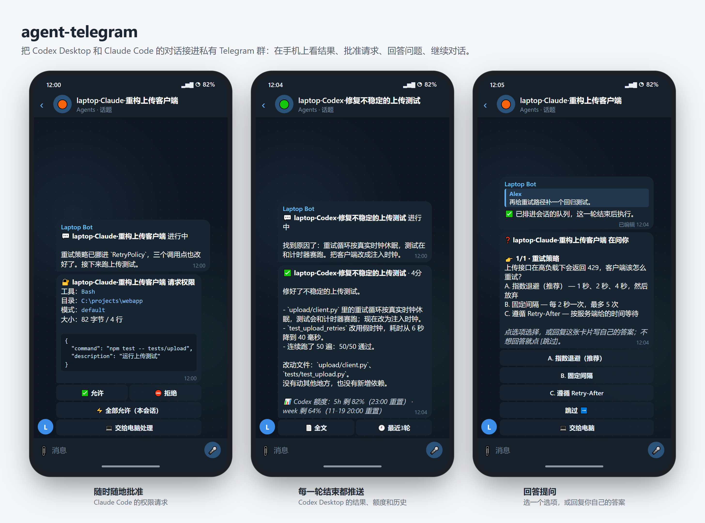

agent-telegram 在 Windows 电脑上后台运行，把 Codex Desktop 和 Claude Code（桌面 App 的 Code 标签或终端 CLI）接到一个私密 Telegram 群。每一轮的结果都会推到手机上。你可以在手机上回答 Claude 的权限请求、提问和计划，审批 Codex 的命令，发下一条指令，或者中断当前回合，不用回到电脑前。

- **每个对话一个话题**，命名为 `机器·代理·标题`，例如 `laptop·Claude·Refactor upload client`。
- **每轮结束都推送**：状态（✅/❌/⏹）、耗时、脱敏后的最终回复前约 1500 字，以及剩余套餐额度。点 **📄 全文** 看完整回复，点 **🕘 最近3轮** 看历史。
- **等待时也能看进度**：一轮进行中，模型对你说的话会出现在一条进度消息里，最多每 30 秒更新。模型私下的思考过程不会推送。
- **审批、提问和计划** 以带按钮的卡片送达。卡片和电脑上的对话框同时可用，先回答的生效。
- **在手机上回复**：在话题里打字，bot 会先复述接收方和内容，确认后才发出。
- **在电脑前时保持安静**：电脑未锁屏且三分钟内动过键盘鼠标时，推送静音；你离开后，需要你处理的消息会响铃。
- **多台电脑，一个群**：每台电脑用自己的 bot，`/list`、`/status`、`/lang` 由每台 bot 各自回答。
- **中英文界面**，在 Telegram 里用 `/lang` 切换。
- 可选的 Antigravity、Pi、DSH（DeepSeek Harness）只读读取器，**默认关闭**。

## 效果演示

每段动图从两边展示同一次交互：左边是电脑，右边是 Telegram 群。Telegram 这一边是桥自己的输出：用演示用的 Claude Code 和 Codex 会话驱动真实的桥代码，bot 设为中文，每条消息、按钮、编辑和提示都和它实际发出的完全一致。电脑这一边是终端里的 Claude Code 和 Codex Desktop 窗口的示意图，和桥的动作同步。会话标题、命令和回答都是虚构的。[英文 README](README.md) 里是同样的流程，bot 用英文界面。

### Claude Code

**审批工具调用。** 权限请求变成一张卡片，列出工具、目录、模式和完整输入；电脑上照常弹出对话框，先回答的生效。**✅ 允许** 仅允许本次，**⛔ 拒绝** 拒绝，**💻 交给电脑处理** 转回电脑上的对话框，**⚡ 全部允许（本会话）** 需要再点一次确认。

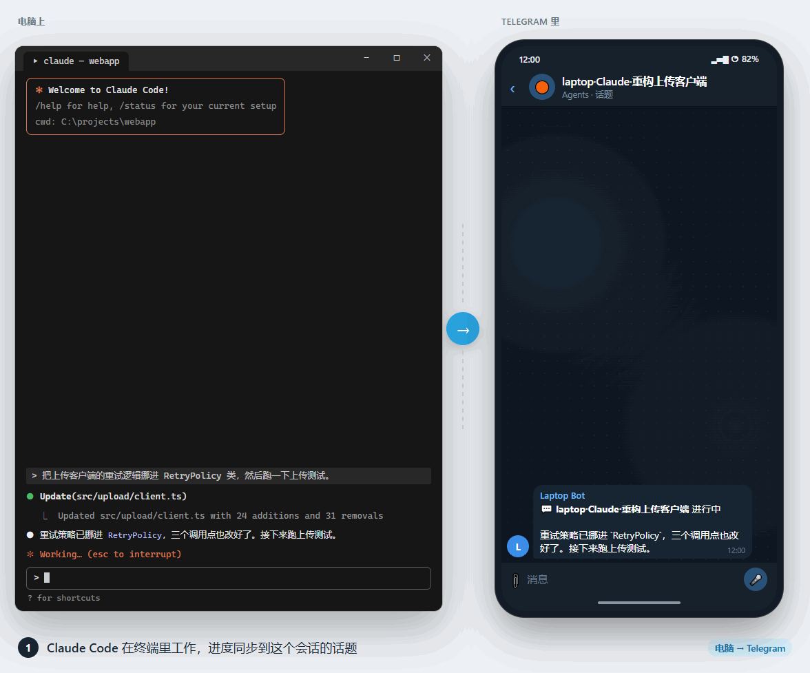

**回答提问。** Claude 向你提问时，卡片上是同样的选项。点一个选项，或回复卡片写自己的答案，核对汇总后点 **📨 发送答案**。电脑上的 Claude 收到回答后继续工作。

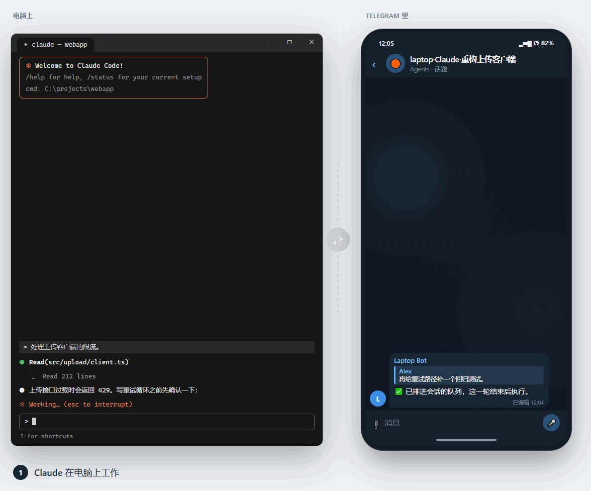

**批准计划。** 等待批准的计划完整送达。**✅ 批准计划** 让 Claude 退出计划模式开始实施；**✏️ 继续规划**，或回复卡片写修改意见，让它继续规划。

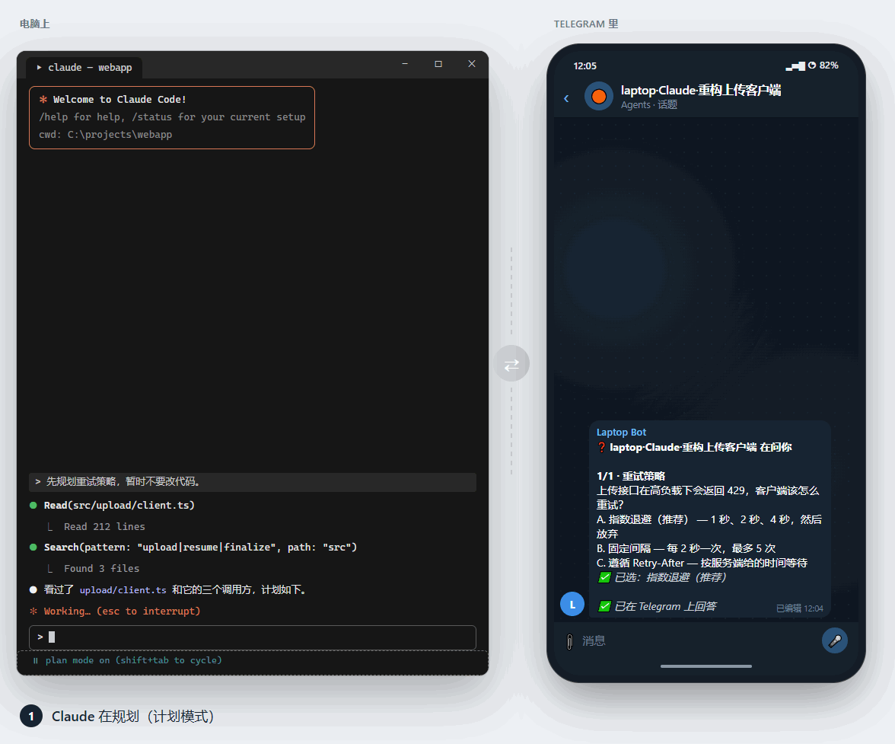

**发下一条指令。** 在对话的话题里打字。Claude 正忙时，可选 **📥 排队：本轮结束后发**（走 Claude 自己的队列，本轮结束后作为新一轮）或 **↪️ 引导：插进这一轮**（在下次工具调用后送达）。

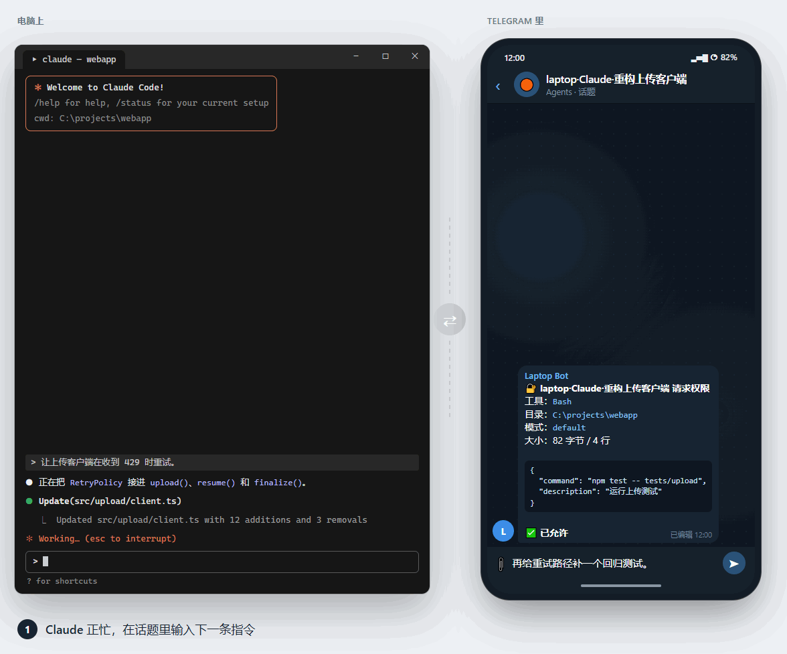

### Codex Desktop

**回合结果。** Codex 工作时有进度消息，结束后推送结果、耗时和套餐额度。**🕘 最近3轮** 就地显示最近的历史。

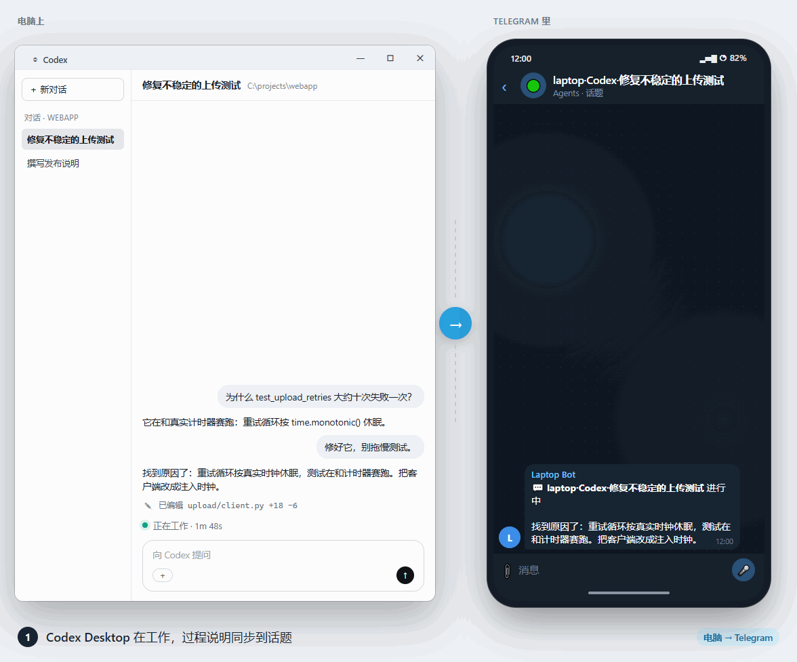

**审批命令。** 对运行命令或修改文件前需要审批的对话，可以在 Telegram 里允许、拒绝，或交还给电脑处理。

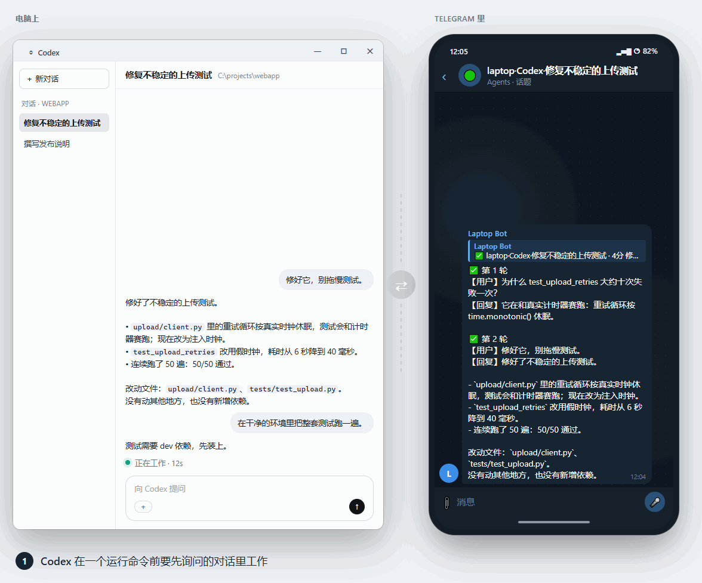

**实施计划。** 计划模式的回合结束后，**🚀 实施此计划** 在确认后让 Codex 切回默认模式并开始实施。直接回复这条消息，则让 Codex 修改计划。

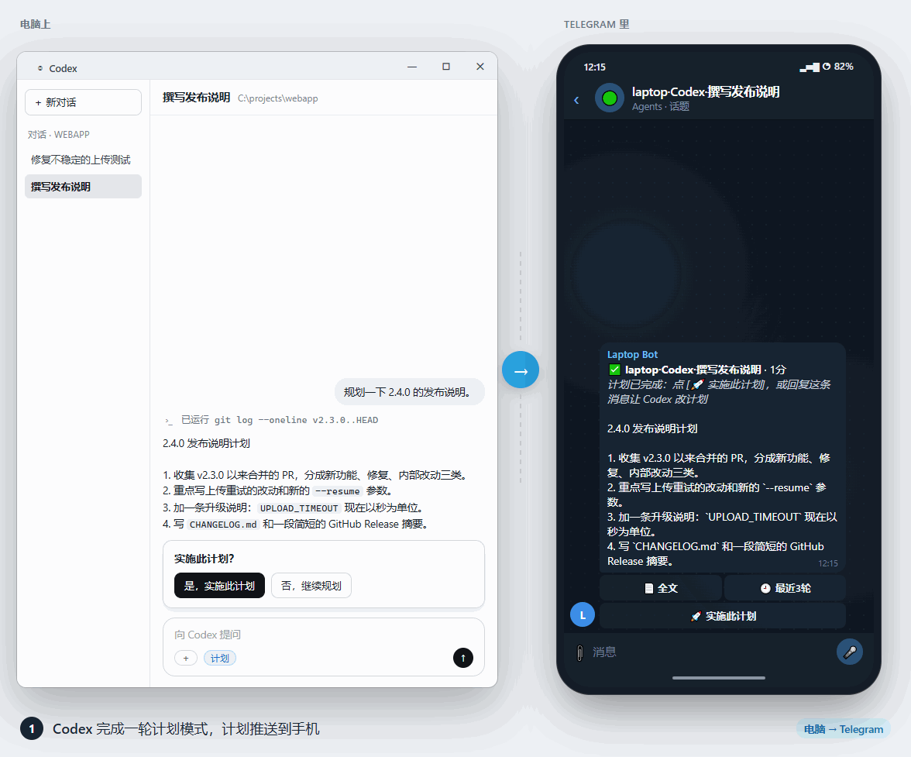

### 手机上

<table>
<tr>
<td width="33%" valign="top">

**通知。** 结果、卡片和提问都以普通 Telegram 通知送达，锁屏上就能看出哪个对话在等你。

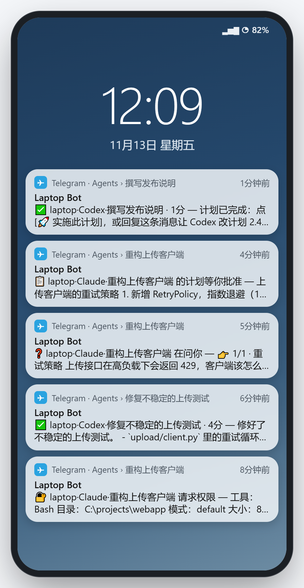

</td>
<td width="33%" valign="top">

**所有电脑。** 在 General 里发 `/list`：每台电脑的 bot 列出本机最近的对话，运行中的排前，按钮可跳转到对应话题。

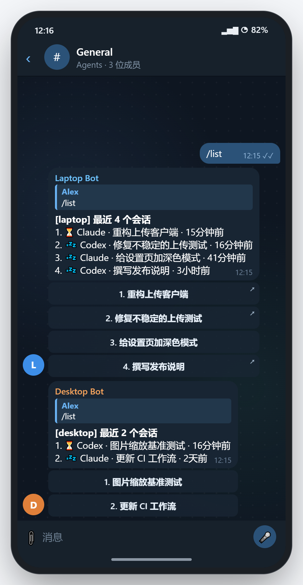

</td>
<td width="33%" valign="top">

**语言。** `/lang` 显示每台机器的语言，带 **English / 中文** 按钮；`/lang en` 或 `/lang zh` 一次切换所有机器。

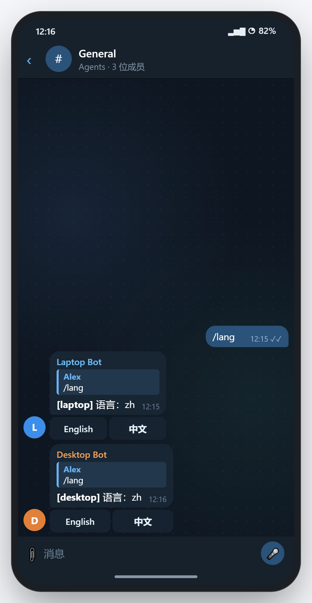

</td>
</tr>
</table>

## 能做什么、不能做什么

| 功能 | Codex Desktop | Claude Code | Antigravity（可选） | Pi（可选） | DSH（可选） |
|---|---|---|---|---|---|
| 每轮结束推送 | 读取本地 rollout | 通过 hooks | 只读 | 只读 | 只读 |
| 发消息 | 通过 app-tools 管道，不切换当前显示的对话 | 运行中：会话收件箱（空闲时开始新一轮，忙时在工具调用之间送达）；已关闭：后台 `claude -p --resume`，需要 CLI 登录 | 不支持 | 不支持 | 不支持 |
| 中断 `/stop` | 无远程接口，请在电脑上停 | 下次工具调用时停下；已运行的命令先跑完 | 不支持 | 不支持 | 不支持 |
| 审批权限 | 命令和文件审批：允许、拒绝、交给电脑（审批策略不是 `never` 的对话）；其他请求只提醒 | 非 bypass 会话支持允许、拒绝、全部允许、交给电脑处理 | 不支持 | 不支持 | 不支持 |
| 新建 `/new` | 在 Codex Desktop 新建任务 | 后台 `claude -p`，目录限配置的 `roots`，需要 CLI 登录 | 不支持 | 不支持 | 不支持 |
| `/list`、`/read`、`/full`、`/status` | 支持 | 支持 | 支持 | 支持 | 支持 |

Codex Desktop 通过 SSH 连接的远程对话，每 30 秒经本机 App 读取一次；标题前有 SSH 别名，例如 `lab1·部署脚本`。这些对话只能查看：支持推送、`/list`、`/read`、`/full`，不能发消息或中断。只看得到 App 最近 50 个对话加置顶对话中的远程会话。

可选读取器读取已有本地文件：Antigravity 的 `~/.gemini`、Pi 的 `~/.pi/agent/sessions`（也支持 `~/.pi/sessions`）、DSH（DeepSeek Harness）的 `~/.dsh/sessions`。支持推送、`/list`、`/read`、`/full`、`/status`，不能回复、中断或新建。启用方法见 **配置**。

Antigravity 读取器只读取 `~/.gemini`（或配置的数据目录）中的本地文件，不会登录、启动或联系 Antigravity，也不会联系任何 Google 服务。启用前请核对 Antigravity 的服务条款。

如果也在使用 codex-watch，因网络错误失败且会自动继续的回合会静音推送，并注明继续时间。

## 环境要求

- Windows 10/11。
- Codex Desktop（Microsoft Store 版）和/或 Claude Code（桌面 App 或 CLI）。只用一个也可以，在配置里关闭另一个。
- [uv](https://docs.astral.sh/uv/)，自动准备 Python 3.11+ 和 httpx、zstandard、pywin32 等依赖。生成的包带 `uv.lock`，安装经过测试的依赖版本。
- 能访问 `api.telegram.org`。支持 HTTP(S) 代理，不支持纯 SOCKS。自动探测依次尝试 `127.0.0.1:7897`（Clash Verge 默认端口）、`HTTPS_PROXY`/`HTTP_PROXY`、Windows 系统代理；否则直连。探测不到时用 `set-token --proxy http://127.0.0.1:7890` 保存代理。

## 一、在 Telegram 里准备

1. 在 @BotFather 用 `/newbot` 给 **每台电脑** 建一个 bot，例如 `yourname_pc1_bot`、`yourname_pc2_bot`。**token 只在下面的 `set-token` 步骤在本机输入，不要给别人或发到任何聊天。**
2. 建私密群，打开 **话题（Topics）**，关闭新成员可见聊天记录；可以开启自动删除消息。
3. 把 bot 拉进群并设管理员，只授予 **管理话题（Manage Topics）**。管理员 bot 能收到所有群消息，不必改隐私模式。
4. 全部加入后，对每个 bot 在 @BotFather 执行 `/setjoingroups` → Disable，防止别人拉入其他群。
5. 在 Telegram 设置 → 隐私与安全开启两步验证。获准向桥发送指令的账号，就能在你的电脑上执行指令。

## 二、安装（每台电脑）

解压到固定目录，用 **普通权限 PowerShell**（不要用管理员，SSH 会话也算管理员）进入包含 `pyproject.toml`、`install_task.ps1` 的 `agent-telegram` 目录：

```powershell
uv sync
.\.venv\Scripts\python.exe -m agent_telegram set-token
# 代理自动探测失败时：
# .\.venv\Scripts\python.exe -m agent_telegram set-token --proxy http://127.0.0.1:7890
.\.venv\Scripts\python.exe -m agent_telegram bind
```

`uv sync` 创建 `.venv` 并安装依赖。`set-token` 隐藏输入 token，用 Windows DPAPI 加密保存。`bind` 显示六位码：在群里发 `/bind@你的bot 123456`，在电脑核对群名和账号后输入 `y`。只有发送此命令的账号进入白名单。

```powershell
powershell -ExecutionPolicy Bypass -File .\install_task.ps1 -Action Install
.\.venv\Scripts\python.exe -m agent_telegram hooks install
```

任务会隐藏启动桥，并在登录时自动运行。只用 Codex 可跳过 `hooks install`。它向 `~/.claude/settings.json` 添加 hooks，先备份到 `~/.claude/backups`，保留其他设置。要求桥已运行；Claude Code 自动重新加载。以后升级时，如已安装的 hook 格式变化，桥启动时会自动更新。

在群里发 `/list`，每台 bot 都应回复。需要新建 Claude 会话或续上已关闭会话时，先在本机运行 `claude`，执行 `/login`。

**移动目录或解压新版本后**，依次重新运行 `uv sync`、`install_task.ps1 -Action Install`、`hooks install`，因为 `.venv` 和 hooks 保存了绝对路径。Install 会等待待确认的发送、已执行的写操作和待发消息处理完；权限审批卡片不阻挡。持续忙碌时只更新任务、不重启桥，空闲后再运行 Install。

## 三、日常使用

- `/list [n]`：各电脑最近 n 个会话，默认 10、最多 30，运行中的排前；前十个有话题跳转按钮。
- `/status`：桥状态。`/help`：帮助。
- `/lang`：显示各机器语言，提供 **English / 中文** 按钮。`/lang en` 或 `/lang zh`（即 `/lang en|zh`）切换群内所有机器。
- 在会话话题打字后确认。会话空闲时卡片是 **✅ 发送** / **✖ 取消**。正在运行时，**📥 排队** 在本轮后开始新一轮：Claude 用自身队列；Codex 由桥最长等四小时，不会出现在 Codex 自身队列里。**↪️ 引导** 插入本轮：Codex 接着处理；Claude 下次工具调用后看到，视作另一会话发来的消息，通常先做完手头动作。
- 提问卡片（Claude 和 Codex）可点选项或回复自己的答案，再点 **📨 发送答案**。Claude 计划卡片可 **✅ 批准计划** / **✏️ 继续规划**，回复卡片可附修改意见。Codex 计划完成后有 **🚀 实施此计划** 按钮。
- 话题里：`/stop` 中断 Claude；`/read [k]` 看最近 k 轮；`/full` 发送最新回复全文（较长时为 `.md` 文件）；`/mute` / `/unmute` 切换推送；`/ask` 恢复逐条审批。
- Claude 权限卡片和电脑对话框同时可用，先回答者生效。**✅ 允许** 仅本次；**⛔ 拒绝**；**💻 交给电脑处理** 关闭卡片，转到本机决定。**⚡ 全部允许（本会话）** 需二次确认，12 小时失效。`/ask`、**🔒 恢复逐条审批**、`/lock`、重启均可取消；每轮推送报告自动允许次数。
- Codex 命令和文件审批卡片有 **✅ 允许**、**⛔ 拒绝**、**💻 交给电脑**，只在审批策略不是 `never` 的对话里出现。
- 在电脑前卡片静音，离开后再响一次；本机处理后标记为已在电脑处理。最多等六小时。你在电脑前时，子代理请求直接交给电脑；这类对话框要等桥响应后才出现。
- `/new@你的bot`：按引导新建 Codex/Claude 会话。General 里直接发 `/new`，每台机器提供选择按钮。
- `/lock`：锁定所有机器写操作。`/unlock@你的bot`：确认后解锁该机器。

其他本机 CLI 命令（示例文件路径按需替换）：

```powershell
.\.venv\Scripts\python.exe -m agent_telegram --help
.\.venv\Scripts\python.exe -m agent_telegram hooks status
.\.venv\Scripts\python.exe -m agent_telegram hooks remove
.\.venv\Scripts\python.exe -m agent_telegram status --lines 30
.\.venv\Scripts\python.exe -m agent_telegram test-push
.\.venv\Scripts\python.exe -m agent_telegram notify --file .\message.txt --silent
# 可加 --photo .\image.png，重复使用，最多十张。
# 不传 --file 时，notify 从标准输入读取 UTF-8 文本。
.\.venv\Scripts\python.exe -m agent_telegram run
```

`run` 是前台运行方式，与计划任务只选一个实例。`test-push` 和 `notify` 向绑定群发送消息。安全锁定时 `notify` 只发脱敏标题、不发图片，退出码 5。`set-token` 和 `bind` 支持 `--proxy auto`、`--proxy direct` 或 HTTP(S) 地址。`set-token --no-check` 跳过 `getMe` token 校验；`hooks install --force` 跳过桥已运行检查，仅在明确排查需要时使用。每个子命令均支持 `--help`。

## 安全设计

- 只接受绑定群和白名单账号。陌生成员加入或发言、成员数超过白名单人数加 `expected_bots`、存在 webhook，或十分钟内两次 token 接收冲突（HTTP 409），会自动锁写。单次 409 可能来自网络中断，只提醒。安全锁定期间只推标题，确认安全后 `/unlock`。
- 发送、中断、新建、解锁都需确认；按钮仅发起人可用，十分钟过期，一次有效。超过十分钟的写消息（包括离线期间发送的）不执行。
- 推送脱敏常见 API key/token、密码赋值、Cookie、私钥和本机配置已知密钥；不推工具输出、推理过程。`content_exclude` 下只推标题。
- 审批卡片只遮已知密钥/token 格式，不隐藏危险命令参数。有遮挡或内容过长时，先 **查看全文** 才显示 **允许**。
- 全部允许仅在内存中、只对单会话有效，需点两次；12 小时、`/ask`、`/lock`、安全锁定、重启都会取消。每次自动允许都记入审计日志。
- Telegram 发起的后台 Claude 默认最高 `acceptEdits`；沿用 bypass 需显式启用 `claude_remote_bypass_allowed`。
- bot token 由 DPAPI 加密；状态目录仅当前账号和 SYSTEM 可访问。
- hooks 只联系本机 `127.0.0.1`。缺 token、未绑定或端口占用导致启动失败时，桥移除全部自身 hooks。剩余风险：崩溃后到任务重启桥之前端口空闲，通常不超过一分钟。

## 配置

首次 `set-token` 生成 `%LOCALAPPDATA%\agent-telegram\tgbridge\config.json`。本机查看和修改：

```powershell
.\.venv\Scripts\python.exe -m agent_telegram config show
.\.venv\Scripts\python.exe -m agent_telegram config set pi_enabled true
# 需要时同样启用其他读取器：
# .\.venv\Scripts\python.exe -m agent_telegram config set antigravity_enabled true
# .\.venv\Scripts\python.exe -m agent_telegram config set dsh_enabled true
# 恢复 Pi 默认关闭：
# .\.venv\Scripts\python.exe -m agent_telegram config unset pi_enabled
.\.venv\Scripts\python.exe -m agent_telegram lang
.\.venv\Scripts\python.exe -m agent_telegram lang en
# 中文使用 lang zh（lang en|zh）。
powershell -ExecutionPolicy Bypass -File .\install_task.ps1 -Action Install
```

`config set KEY VALUE` 校验输入，`config unset KEY` 恢复默认。布尔值可用 `true`/`false`，列表使用 JSON。`lang en|zh` 保存本机语言。本机修改配置或语言后，执行最后的 Install 命令重启；运行中的桥可通过 Telegram `/lang` 切语言。只启用自己需要的读取器。

| 键 | 默认 | 说明 |
|---|---|---|
| `language` | `en`（实际值；空值用发行版默认） | 英文 `en` 或中文 `zh` |
| `machine` | 去掉用户名前缀的主机名 | 话题和回复中的机器名 |
| `proxy` | `null` | 自动探测；空字符串直连；或 HTTP(S) 地址 |
| `expected_bots` | 2 | 群内机器 bot 数；超过两台电脑时增加 |
| `recent_n` | 10 | `/list` 默认条数，1–30 |
| `summary_chars` | 1500 | 推送中最终回复字数 |
| `presence_idle_s` | 180 | 多少秒未动键盘鼠标算离开 |
| `roots` | 用户目录 | Claude `/new` 可选目录及其下符合条件的最近目录 |
| `content_exclude` | `[]` | 只推标题的目录 |
| `codex_enabled` / `claude_enabled` | `true` | 关闭不用的代理 |
| `codex_include_automation` | `false` | 推送 Codex 自动化会话 |
| `codex_remote_enabled` | `true` | 推送 Codex Desktop SSH 远程会话 |
| `codex_remote_hosts` | `[]` | SSH 别名/主机 ID；空表示全部 |
| `codex_remote_poll_s` | 30 | 远程轮询秒数，最少 10 |
| `antigravity_enabled` | `false` | 启用只读 Antigravity 读取器 |
| `antigravity_home` | 空（`~/.gemini`） | Antigravity 数据目录 |
| `pi_enabled` | `false` | 启用只读 Pi 读取器 |
| `pi_home` | 空（`~/.pi`） | 读取其下 `agent/sessions`、`sessions`；也接受 `~/.pi/agent` |
| `dsh_enabled` | `false` | 启用只读 DSH（DeepSeek Harness）读取器 |
| `dsh_home` | 空（`~/.dsh`） | 包含 `sessions` 的 DSH 根目录 |
| `progress_enabled` | `true` | 推送本轮进行中模型对你说的话 |
| `progress_new_message_s` | 600 | 进度消息另起一条的秒数 |
| `quota_enabled` | `true` | 推送和 `/status` 显示可用的套餐用量信息 |
| `claude_include_scheduled` | `false` | 推送 Claude 定时会话 |
| `claude_remote_bypass_allowed` | `false` | 允许后台运行沿用 bypass 权限模式 |
| `claude_max_headless` | 2 | 最多同时运行的后台 Claude 数 |
| `hook_port` | 8767 | 本地 hook 端口；修改后重启并重装 hooks |

`config show` 还列出其他参数及实际默认值。绑定字段由 `bind` 管理，不能用 `config set` 修改。

## 排查

```powershell
.\.venv\Scripts\python.exe -m agent_telegram status
powershell -ExecutionPolicy Bypass -File .\install_task.ps1 -Action Status
```

日志：`%LOCALAPPDATA%\agent-telegram\logs\bridge.log`（可读）及同目录的 `audit.jsonl`（每个操作一条，不含消息全文）。

- `/list` 无响应：查 `bridge.log`，常见原因是代理没开或 token 错误。
- 缺 token、未绑定、端口占用导致 hooks 被移除：先解决原因，运行 `install_task.ps1 -Action Install`，再 `hooks install`。
- Claude 收件箱尚未报告：安装 hooks 后，该会话至少开始或结束一轮。
- 超过两台电脑持续锁定：将 `expected_bots` 改为电脑数，重启后 `/unlock@你的bot`。
- token 泄露：@BotFather `/revoke`，再 `set-token`、`install_task.ps1 -Action Install`。
- 两台共用 token：Telegram 返回 409，两边可能锁定；每台必须用自己的 bot。
- 可选来源没出现：查 `config show`，启用对应项，确认本地会话存在后重启。

## 卸载

```powershell
powershell -ExecutionPolicy Bypass -File .\install_task.ps1 -Action Remove
```

先移除 hooks 再删除任务。token、配置、状态和日志留在 `%LOCALAPPDATA%\agent-telegram`，不再需要可自行删除该目录。

## 测试

```powershell
uv run pytest
```

默认排除连接真实应用的 live 测试。

`images/`（英文）和 `images/zh/`（中文）里的图片可在介绍本项目时按下方许可证使用。

## 许可证

© 2026 wandugu。采用 [CC BY 4.0](LICENSE)（知识共享署名 4.0 国际许可协议）。参见[许可协议说明](https://creativecommons.org/licenses/by/4.0/)。

项目：[agent_telegram_remote](https://github.com/wandugu/agent_telegram_remote)。
